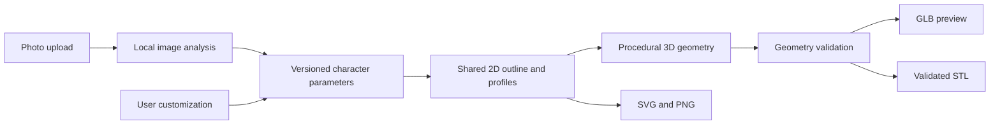

# Photo-to-Minifigure

A planned web application that turns a photograph into an original, brick-toy-inspired character, a 2D outline, and a downloadable 3D model. Face Only creates a personalized head; Full Body creates a complete stylized character with a simplified hairstyle and outfit.

**Repository status: planning and initialization only.** There is no runnable application, dependency manifest, installed toolchain, or implemented API yet. All features and development commands below are planned. Implementation starts with Phase 1 of [PLANS.md](PLANS.md).

The project uses its own visual language and procedural assets. It is not affiliated with LEGO and does not use official branding, proprietary models, or promised connector compatibility.

## Planned features

- Upload one JPEG or PNG containing one person, with clear guidance for each mode.
- Analyze visible face and body landmarks locally on the backend, without paid AI APIs.
- Suggest editable character parameters, distinguish uncertain suggestions from observations, and request input for unsupported features.
- Generate synchronized SVG/PNG outlines and procedural 3D geometry.
- Customize facial details, hairstyle, clothing style, and colors.
- Orbit, zoom, and inspect a server-generated GLB preview, including a geometry-focused print view.
- Download GLB and a validated, single-piece STL with dimensions and a validation report.
- Delete photos after analysis; expire derived artifacts automatically.

STL does not carry the preview's colors or materials. Passing geometry checks means the model meets a documented print profile; printer setup, supports, and physical testing still matter. See [PRINTING.md](docs/PRINTING.md).

## Planned technology stack

| Area | Tools and role |
| --- | --- |
| Frontend | React, TypeScript, Vite, Tailwind CSS |
| 3D viewer | Three.js, React Three Fiber, Drei |
| HTTP API and contracts | Python, FastAPI, Pydantic/OpenAPI |
| Local image analysis | OpenCV, Pillow, MediaPipe, NumPy |
| Outlines and geometry | Shapely, procedural solids, Trimesh, Manifold3D for solid Boolean operations |
| Planned checks | ESLint, Prettier, TypeScript, Vitest, Testing Library, Playwright; Ruff, mypy, pytest |

Phase 1 will verify runtime and package compatibility on Windows and Linux, then pin supported versions and commit lockfiles. No packages are installed during repository initialization.

## Proposed architecture



The browser owns the editing experience. A modular FastAPI backend owns analysis, canonical parameter validation, outlines, solid geometry, and export validation. CPU work runs outside the API event loop in a bounded local worker. Ephemeral jobs and files provide anonymous sessions without a database or account system. Each result records its parameter revision and generator/profile versions so stale previews and downloads cannot be presented as current.

## Repository structure

Directories below exist as placeholders; their responsibilities are planned.

```text
frontend/
  public/                  Original static assets only
  src/
    app/                   Application composition and workflow state
    components/ui/         Shared accessible UI primitives
    features/
      upload/              Mode selection and upload interaction
      character/           Parameter review, outlines, and customization
      viewer/              GLB viewer and print inspection
      exports/             Validation status and downloads
    lib/api/               Typed API client and job polling
    types/                 Generated API types and frontend-only types
    test/                  Shared frontend test setup
  tests/e2e/               Browser smoke tests
backend/
  app/
    api/                   Thin HTTP adapters
    core/                  Settings, lifecycle, errors, privacy controls
    schemas/               Authoritative versioned data contracts
    services/
      analysis/            Decode, landmarks, feature extraction, mapping
      outlines/            Shared 2D profiles and SVG/PNG output
      geometry/            Head/body solids and mesh assembly
      validation/          Geometry and print-profile checks
      exports/             GLB/STL serialization and artifact manifests
      jobs/                Bounded worker, temporary files, expiry
  models/                  Ignored local model assets; provenance documented later
  tests/
    unit/
    integration/
    fixtures/              Synthetic or explicitly licensed, non-personal fixtures
docs/                      Product, architecture, printing, decisions
scripts/                   Future development and verification helpers
```

## Local development — planned, unavailable until Phase 1

These commands describe the intended interface. `package.json`, `backend/pyproject.toml`, lockfiles, settings loaders, and the server entry point do not exist yet. Do not run this sequence as an initialization task.

Phase 1 prerequisites: a verified supported Node.js LTS release, npm, a compatible Python release, and Git. Python 3.11 is an initial compatibility candidate, not a pinned support promise. Local MediaPipe model downloads will need documented sources, checksums, and license review before Phase 3; inference must work offline after setup.

From the repository root, planned PowerShell setup:

```powershell
Copy-Item .env.example .env
python -m venv .venv
.\.venv\Scripts\Activate.ps1
python -m pip install -e "./backend[dev]"
npm --prefix frontend ci
```

Planned POSIX equivalents for the first three steps:

```sh
cp .env.example .env
python -m venv .venv
. .venv/bin/activate
```

Run two terminals from the root after setup:

```powershell
# Backend, with the virtual environment activated:
python -m uvicorn app.main:app --app-dir backend --reload --host 127.0.0.1 --port 8000
```

```powershell
# Frontend:
npm --prefix frontend run dev -- --host 127.0.0.1 --port 5173
```

Planned addresses: UI `http://127.0.0.1:5173`, health `http://127.0.0.1:8000/healthz`, API docs `http://127.0.0.1:8000/docs`. Vite will proxy `/api` and `/healthz` to port 8000, allowing the first connectivity check before product routes exist. Both settings loaders will explicitly read the root `.env`; backend relative paths resolve against the repository root. Browser-exposed `VITE_*` values must never contain secrets.

Planned verification commands, from the root:

```powershell
npm --prefix frontend run lint
npm --prefix frontend run format:check
npm --prefix frontend run typecheck
npm --prefix frontend run test -- --run
npm --prefix frontend run build
python -m ruff check backend
python -m ruff format --check backend
python -m mypy --config-file backend/pyproject.toml backend/app
python -m pytest backend/tests
```

Phase 7 will add `npm --prefix frontend run test:e2e` with documented browser prerequisites and managed test servers. Required test files and markers for each milestone are specified in [PLANS.md](PLANS.md); no checks are represented as passing before implementation.

## MVP scope

Both generation modes, actual image-derived personalization, user review of uncertain features, synchronized outlines and 3D assets, basic appearance controls, geometry validation, and downloadable STL/GLB/SVG/PNG are required. The initial manufacturing target is a solid, fused, non-articulated display model. A single photograph provides approximate visible appearance, not a scan or an accurate reconstruction of hidden surfaces.

Authentication, accounts, payments, shipping, orders, ecommerce, persistent galleries, unrestricted generated meshes, exact body measurements, and mechanical compatibility with existing toys are outside the MVP.

## Documentation and future roadmap

- [AGENTS.md](AGENTS.md): persistent engineering rules and conventions.
- [PLANS.md](PLANS.md): unchecked implementation milestones and MVP definition of done.
- [Product requirements](docs/PRD.md): users, workflows, requirements, and scope.
- [Architecture](docs/ARCHITECTURE.md): proposed contracts, data flow, and module boundaries.
- [Printing](docs/PRINTING.md): dimensions, constraints, validation, and limitations.
- [Decisions](docs/DECISIONS.md): accepted choices, provisional targets, and open questions.

After the MVP, potential work includes additional hairstyles/outfits, improved local segmentation, multi-view input, optional split parts, 3MF, and additional printer profiles. Each requires a new scoped decision and plan; none is implicitly authorized by this initialization.
