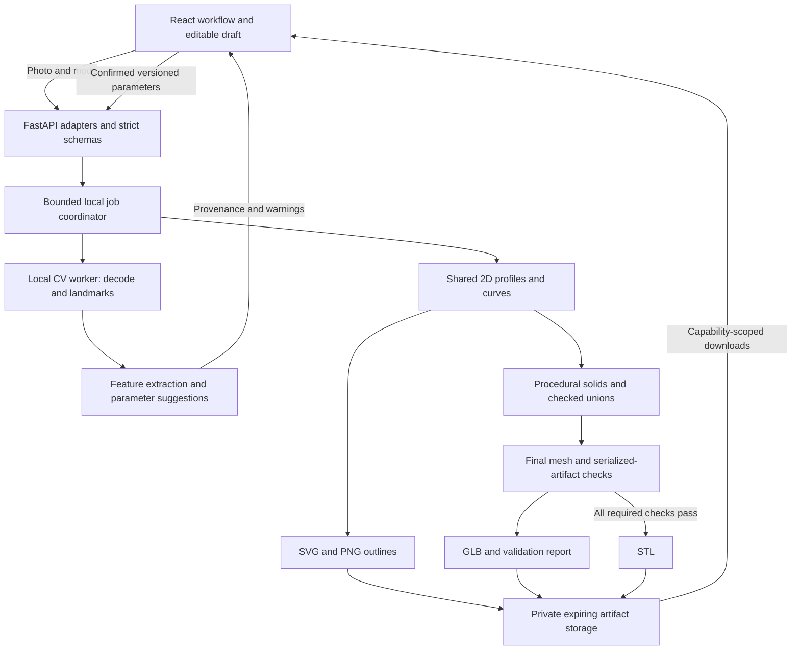

# Proposed system architecture

Status: design only. No modules, routes, schemas, worker, analysis, or geometry described here are implemented. Consult [PLANS.md](../PLANS.md) for phase dependencies and [DECISIONS.md](DECISIONS.md) for the rationale and open gates.

## System overview



Use one web frontend and one modular backend with local worker subprocesses. No account, database, broker, cloud inference service, or ecommerce system is needed. The initial deployment model is a local/controlled demonstration with one API coordinator; separate public-hosting requirements are outside MVP.

The canonical pipeline is photo -> analysis -> parameters -> 2D outline/profiles -> procedural 3D geometry -> validation -> STL. Shared profiles provide front-view feature paths and cross-sections, not a claim that extruding one silhouette reconstructs a person. Three-dimensional depth, joins, and back surfaces come from original bounded templates. Polished outline downloads arrive in Phase 4 using the profiles introduced in Phase 2.

## Frontend architecture

`src/app` composes a small workflow: select mode -> choose photo -> analyze -> review suggestions -> generate -> customize/inspect -> export. Each stage has explicit loading, error, and recovery states. Features own their components/hooks/tests; `components/ui` contains accessible shared primitives; `lib/api` owns typed requests and polling; `types` receives generated OpenAPI types.

Keep local state/reducers before adding a state library. Important state consists of:

- A temporary browser `File` and object URL, released on replacement/delete/unmount.
- Analysis suggestions and per-field provenance, without needing the photo after analysis.
- An editable parameter draft, monotonic `client_revision`, and last confirmed server result.
- Current analysis/generation job capability and lifecycle stage.
- Artifact manifest/validation report for one immutable `revision_id`.

The browser checks files for immediate feedback, while the server remains authoritative. On edits, debounce generation and invalidate current export eligibility immediately. Preserve a prior preview only with an explicit stale label. Apply a response only if its echoed client revision matches the current request; an older response must never overwrite newer state. Abort polling and request job deletion when abandoning work where practical.

The viewer loads server-generated GLB through React Three Fiber/Drei, with orbit/zoom, bounds, dimensions, neutral lighting, and a geometry-focused print view. It does not implement an independent final mesh generator. Color/material changes may alter the GLB appearance but must not imply STL color. Dispose replaced resources. Keep essential dimensions/status/errors in accessible HTML; provide a WebGL-unavailable state.

## Backend modules and boundaries

| Module | Input -> output | Constraints |
| --- | --- | --- |
| `api` | HTTP -> schema/service calls | Thin adapters, status codes, safe envelopes, no numerical algorithms. |
| `core` | Root environment -> validated settings/lifecycle | Paths, safe logging, errors, startup/shutdown cleanup. |
| `schemas` | Untrusted JSON/form values -> typed models | Authoritative versions, bounds, enums, mode-specific rules. |
| `services/analysis` | Bounded decoded image -> suggestions/provenance | Local models only, real observations, no hidden photo persistence. |
| `services/outlines` | Canonical parameters -> shared profiles and SVG/PNG | Safe closed profiles/curves, bounded raster size. |
| `services/geometry` | Profiles + parameters/profile -> final solid mesh | Deterministic templates, checked unions, fixed units. |
| `services/validation` | Final mesh/STL -> report | Required checks fail closed; no unsupported print claims. |
| `services/exports` | Final mesh + report -> artifacts/manifest | Same revision, serializer checks, no unsafe paths. |
| `services/jobs` | Valid work request -> ephemeral lifecycle | Bounded queue/worker, deadlines, capability access, expiry. |

Pure computational services accept data objects/arrays and return results or domain errors. The coordinator owns filesystem and process side effects. Do not pass HTTP objects deep into geometry or detector code. Model assets live in ignored `backend/models/` with documented source/version/checksum/license before use.

## Jobs, storage, and privacy lifecycle

Begin with one active CPU worker subprocess and four queued jobs; run only one API coordinator. A supervised subprocess per active job makes a hard deadline actionable on Windows and Linux without introducing a distributed queue. Record model-loading overhead and revisit a persistent pool only if measured evidence warrants it. Heavy work stays outside the API event loop; [FastAPI notes that heavy background computation differs from small background tasks](https://fastapi.tiangolo.com/tutorial/background-tasks/#caveat).

Jobs have `kind: analysis | generation` and `state: queued | running | succeeded | failed`. Stages are named work states such as `decoding`, `detecting`, `mapping`, `outlining`, `building`, `validating`, and `serializing`, not fabricated progress percentages. The initial deadline covers queue wait plus execution: 120 seconds from submission. An expired deadline terminates the worker and produces a safe `job_timeout` failure.

1. Validate admission limits before enqueueing. Reject a saturated queue, insufficient disk budget, or invalid upload early.
2. Mint a cryptographically random job capability with at least 256 bits of entropy. IDs are unguessable access capabilities, not sequential database keys; never log/share them or expose a listing endpoint.
3. Use server-created private job directories outside `frontend/public`, with generated names and path containment checks. Client filenames do not affect paths. Apply the 512 MiB aggregate temporary-disk limit to queued inputs and outputs, not only individual uploads.
4. Store raw bytes only while queued/being analyzed; remove raw/normalized/cropped inputs in `finally` on success/failure. Do not return raw landmarks or normalized photos to the browser unless a future reviewed requirement needs them.
5. Stop and join killed/deleted workers before removing their files so they cannot recreate data; handle Windows open-file races explicitly. Terminate the child before reporting timeout cleanup complete.
6. Keep minimum required parameters, field provenance, reports, and generated artifacts for a fixed one-hour lifetime after completion; downloads do not extend retention. No photo is retained for that artifact TTL.
7. Deleting a job cancels active work and removes its results/artifacts. Deleting the browser session must request deletion of all its known analysis/generation jobs and release local image references.
8. Use periodic expiry plus startup/shutdown cleanup. Purge previous-run temporary data before accepting jobs because there is no durable registry/recovery promise. Validate the configured data directory before cleanup; never traverse or recursively remove an arbitrary user path.

Results are lost on restart. A page refresh may lose local edits. The browser must recover with an expired/unavailable message rather than pretending results persist. Derived geometry and outlines can identify someone too; use private/no-store responses and redact access capabilities from application/access logs. Do not claim forensic secure erasure from normal application cleanup.

## API proposal

All product endpoints use `/api/v1`; fields use JSON `snake_case`. OpenAPI/Pydantic is the eventual executable contract, with frontend types generated from it. Documentation examples here are illustrative, not implemented responses.

| Method and path | Request | Proposed response |
| --- | --- | --- |
| `GET /healthz` | None | `200` service status; no private settings. |
| `POST /api/v1/analyses` | Multipart `file` and `mode` (`face_only` or `full_body`) | `202` analysis job capability and status URL. |
| `POST /api/v1/generations` | JSON `{client_revision, parameters}` | `202` generation job capability and status URL. |
| `GET /api/v1/jobs/{job_id}` | Capability in path | `200` state/stage; terminal result or safe error when available. |
| `GET /api/v1/jobs/{job_id}/artifacts/{artifact_id}` | Opaque artifact ID, scoped to job | `200` private binary/text artifact; no arbitrary filename lookup. |
| `DELETE /api/v1/jobs/{job_id}` | Capability in path | `204` after work stops and temporary data is deleted; repeat deletion also `204`. |

Creation returns `Location`, `job_id`, `kind`, `state`, `status_url`, `deadline_at`, and `request_id`. Completion adds `expires_at`. Polling uses a modest interval/backoff and terminates at a terminal state; rate limits or queue pressure may return `Retry-After`. No endpoint accepts remote image URLs, arbitrary meshes, geometry scripts, or SVG uploads.

An analysis success returns `suggested_parameters`, per-field `field_provenance`, `warnings`, and `review_required_fields`. Example field metadata: `{source: "heuristic", confidence: null, reason_code: "hair_style_uncertain"}`. Confidence is nullable and method-specific; a landmark detector score is not a calibrated probability that a hairstyle is correct. Defaults must say `source: "default"`.

A generation success returns echoed `client_revision`, canonical resolved parameters, `revision_id`, a validation summary/report, warnings, and an artifact manifest. `succeeded` means computational completion; `validation.status` separately determines export eligibility. A review-only GLB can coexist with `failed`/`unknown` validation, clearly labeled, with **no STL artifact**. If no meaningful mesh/result can be produced, the job itself fails.

Each artifact entry includes `artifact_id`, kind (`outline_svg`, `outline_png`, `preview_glb`, `model_stl`, or `validation_json`), MIME type, byte size, SHA-256, revision, expiry, and a job-scoped URL. Publish manifests atomically so partially written files cannot be downloaded. STL delivery independently verifies that the artifact is approved for that revision/checksum; editing frontend controls cannot bypass the gate.

HTTP errors use an envelope such as:

```json
{
  "error": {
    "code": "insufficient_body_landmarks",
    "message": "Use one photo with a visible face, torso, arms, and legs.",
    "retryable": false,
    "request_id": "opaque-request-id",
    "details": {"fields": ["file"]}
  }
}
```

Terminal failed jobs include that safe error object inside the job envelope; polling an existing failed job still returns `200`. Use `413` for byte/pixel limit rejection, `415` for unsupported media, `422` for invalid mode/parameters or decoded input, `429` for queue pressure, `503` for unavailable required services/models, and `500` only for unexpected failures. No/multiple faces or insufficient landmarks discovered asynchronously produce terminal job error codes rather than pretending the original `202` failed synchronously. Unknown/deleted/restart-lost jobs return `404`; expired jobs may return `410` while a non-personal tombstone exists, otherwise `404`. Both mean the UI must regenerate/reupload.

## Character parameter proposal

The executable Pydantic/JSON Schema will be created in Phase 2. The following payload is an illustrative design example, **not** output from a photograph and not an existing implementation. Initial option names/ranges must be tested and documented when finalized.

```json
{
  "schema_version": "1.0",
  "mode": "full_body",
  "style_id": "brick_original_v1",
  "units": "mm",
  "target_height_mm": 80.0,
  "print_profile": "fdm_standard_v1",
  "head": {
    "shape": "rounded_block",
    "width_scale": 1.0,
    "depth_scale": 1.0
  },
  "face": {
    "eye_spacing_ratio": 0.4,
    "eye_width_ratio": 0.08,
    "brow_tilt_deg": 0.0,
    "mouth_curve": 0.4,
    "relief": "raised"
  },
  "hair": {"style": "short", "volume": 0.5},
  "body": {
    "pose": "neutral_standing",
    "shoulder_width_scale": 1.0,
    "torso_length_scale": 1.0,
    "upper_style": "plain",
    "lower_style": "trousers"
  },
  "colors": {
    "skin": "#CFA07C",
    "hair": "#3C2B20",
    "eyes": "#242424",
    "upper": "#3568A8",
    "lower": "#303A4A",
    "footwear": "#252525"
  }
}
```

Proposed validation rules:

| Field group | Rule |
| --- | --- |
| Identity/version | Reject unsupported schema/style/profile versions and unknown properties; never interpret missing critical fields silently. |
| Mode/size | `face_only`: `body` is null and 20–40 mm target height, default suggestion 24; `full_body`: body required and 60–120 mm, default suggestion 80. Height includes hair. |
| Shape/scales | Initial head shape `rounded_block`; head width/depth and body shoulder/torso scales bounded to 0.8–1.2 relative to original style ratios. |
| Face | Eye-center spacing 0.2–0.6 of head width; eye width 0.04–0.12 of head width; brow tilt -25–25 degrees; normalized mouth curve -1–1; relief `raised` or `engraved`. |
| Hair | Proposed small catalog `none`, `short`, `long`; normalized volume 0–1. Styles and bounds also need geometry/profile combination checks. |
| Body | Fixed `neutral_standing`; proposed upper `plain`/`jacket`, lower `trousers`/`shorts`. Photo pose does not become arbitrary joint geometry. |
| Colors | Explicit sRGB `#RRGGBB`; skin/hair/eyes in both modes; clothing/footwear fields only for Full Body. No sensitive-attribute labels. |
| Numbers | Reject non-finite or coercion-ambiguous values. Distinguish normalized ratios from degrees/mm in names and schemas. |

Face Only uses the same head/face/hair groups, with `body: null` and no clothing/footwear colors. Use discriminated mode schemas rather than silently ignoring body parameters. Selected styles determine fixed original nose/ear/hand details initially; expand the catalog only with tests and a scoped requirement.

Parameter validity is not sufficient for print validity: combinations can still violate final-scale features. Geometry checks must reject or explicitly propose an adjustment. If adjusted parameters are accepted, return those resolved values and issue a new revision. No silent mesh changes under an unchanged parameter identity.

The provenance envelope is separate from canonical parameters so a user's confirmed geometry has a stable identity independent of detector metadata. Canonicalize numeric representation and key order, and compute `revision_id` from resolved parameters plus generator/profile versions. Version validation separately and bind its report to exact STL bytes. Exclude filenames/photos/landmarks from hashes and logs; a revision hash is an integrity identifier, never an access credential.

## Image-processing strategy

1. Accept one JPEG/PNG under 10 MiB and 20 million decoded pixels; reject unsupported/animated/corrupt content and enforce decoder limits before expensive allocation.
2. Apply EXIF orientation, strip metadata, normalize to a known color representation, and resize analysis input to a maximum 2048-pixel dimension. Explicitly convert Pillow/MediaPipe RGB and OpenCV channel conventions. Handle PNG transparency with a documented neutral background.
3. Use local MediaPipe Face Landmarker and, for Full Body, Pose Landmarker with versioned task assets. Configure ambiguity detection: do not set the detector to a single result and then claim multiple people have been ruled out. Evaluate a multi-subject detection pass or supported multi-result configuration; reject ambiguous input.
4. Establish usable landmarks/visibility and crop/blur thresholds using representative fixtures. A missing/too-small face in Full Body prompts better input rather than creating invented facial data.
5. Extract normalized face geometry and representative colors from safe regions, with occlusion/lighting warnings. For Full Body, map pose ratios to a neutral stylized template; never claim metric body measurements.
6. Attempt only bounded hair/clothing heuristics; local face/pose detection does not automatically classify arbitrary hairstyles or outfits. Unknown details remain explicit review-needed defaults. [MediaPipe's face](https://developers.google.com/edge/mediapipe/solutions/vision/face_landmarker/python) and [pose](https://developers.google.com/edge/mediapipe/solutions/vision/pose_landmarker/python) task guides describe the underlying landmark outputs.
7. Return suggested parameters/provenance, then discard images/temporary crops and unnecessary landmarks. Retain enough derived parameter suggestions for reset, not enough imagery to rerun analysis without reupload.

No remote inference or photo-upload service is used. Download approved model weights during setup, document source/checksum/license, and verify inference offline. Do not infer identity, ethnicity, gender, health, personality, or hidden-body attributes.

## Outline and geometry strategy

Define shared front-plane paths and valid planar regions in a documented normalized feature frame. Face paths map to the head's front surface; body paths map to the supported torso/limb templates. SVG converts front-plane vertical coordinates to screen-down Y explicitly. Left/right always identifies the subject's side; preserve EXIF-normalized image orientation rather than introducing an accidental mirror.

Generate outline SVG from safe paths and fixed styling, without executable or external content. Draw PNG from the same path definitions with Pillow where practical; cap raster dimensions and document any tessellation difference. Outlines communicate a stylized design, not a 3D scan or an exact silhouette from every view.

Generate original head/hair/face and body primitives with bounded proportions. Fuse positive overlaps using checked Manifold3D Boolean operations. Engraved details use checked differences with enough remaining material. Avoid zero-thickness tips, tangent-only joins, internal overlaps, detached facial details, and arbitrary user geometry. Keep a mapping of analytic feature dimensions so validation can inspect known structural minima.

Normalize final size, preserve broad structural joins, and check dimensions/features at final scale. If a minimum cannot be met, return a blocked result or an explicit adjustment proposal. Do not replace geometry with an attractive texture or remove distinctive features silently. [PRINTING.md](PRINTING.md) defines provisional size, thickness, topology, and tessellation limits.

## Export and validation pipeline

1. Validate canonical parameters and compute profiles; reject invalid 2D rings/intersections.
2. Build and union/difference bounded solids; capture engine failures and analytical dimensions.
3. Validate the final mesh including manifold vertices/edges, connected components, outward winding, positive volume, intersections, dimensions, and profile-aware features.
4. Generate final surface material regions for GLB without adding overlapping duplicate geometry. Preserve physical relief even in a plain material view.
5. Serialize STL in millimeters, reload exact bytes, and verify all required checks and expected bounds/volume/tolerances again.
6. Serialize GLB in meters/Y-up, round-trip transforms, and compare geometric surface/bounds to STL. Decorative lights/grid/camera exist only in the viewer.
7. Emit a report with per-check `passed | failed | unknown`, revision/versions, exact-file checksum, measurements, and support advisories. A required unknown result blocks STL just like failure.
8. Atomically publish the current SVG/PNG/GLB/report and, only on a passed report, STL. If validation is blocked, label any GLB as review-only.

Watertightness, valid-volume checks, and Boolean success do not establish every thickness/intersection constraint; [Trimesh documents their individual meanings](https://trimesh.org/trimesh.html#trimesh.Trimesh.is_watertight). Resolve the robust method/coverage question before enabling validated STL. Test actual serialized outputs, not only in-memory primitives. A slicer/physical print is further evidence, separate from software geometry validation.

## Error handling and security

Translate domain errors at the API/job boundary into stable safe codes. Expected categories include `unsupported_media`, `image_too_large`, `invalid_image`, `no_face`, `multiple_people`, `insufficient_face_landmarks`, `insufficient_body_landmarks`, `model_unavailable`, `invalid_parameters`, `queue_full`, `job_timeout`, `geometry_failed`, `geometry_validation_failed`, and `artifact_expired`. Return request identifiers and safe field/report context; never local paths, model internals, image bytes, stack traces, or raw exception strings.

Limit accepted modes/options and request bodies; validate all filesystem containment. Restrict CORS to configured development origins. Vite proxies `/api` and `/healthz` locally, keeping browser requests relative, including the foundation connectivity check. Both services explicitly load root `.env`; `VITE_*` is public. Log safe stage durations/codes/resource summaries only, redacting job URLs/tokens and personal results. Keep sensitive responses `Cache-Control: private, no-store` and apply a restrictive referrer policy to avoid leaking capabilities. Delete means application cleanup, with explicit error handling if a file cannot be removed.

Local binding and a controlled demo are the initial assumptions. A public deployment requires separate operational decisions; no authentication/account system is introduced implicitly.

## Verification and tradeoffs

Contract tests cover modes/versions/envelopes; unit tests cover deterministic mapping/profiles/transforms; integration tests cover local inference, real worker lifecycle, limits, deletion, and actual serialization. Real end-to-end tests complete both photo flows with approved fixtures and a meaningful edit. Use geometry boundary matrices and deliberately invalid artifacts, not screenshot appearance alone.

Server-owned geometry favors consistency over instant client-only mesh edits, so edits require debounced jobs and honest waiting. Local CV favors privacy/cost over unrestricted semantic inference, so review is part of the product. Fused solids favor print robustness over articulation. Temporary jobs favor limited data retention over recovery/history. Schema/version discipline adds modest upfront work to prevent divergent outputs. Open engine/validation, profile, model-license, and runtime choices are tracked in [DECISIONS.md](DECISIONS.md), with explicit resolution gates in [PLANS.md](../PLANS.md).
